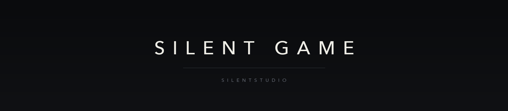

  

  <a href="README.md">简体中文</a> · <a href="README.en.md">English</a> · <a href="README.ja.md">日本語</a> · <a href="README.ko.md">한국어</a> · <a href="README.fr.md">Français</a> · Deutsch · <a href="README.es.md">Español</a> · <a href="README.ru.md">Русский</a>

Silent Game ist das Spiele-Team von SilentStudio.

Wir entwickeln für Windows, macOS, iOS und Android und schreiben auch die Engine, die Werkzeuge und die Formate darunter. Der größte Teil der Arbeit passiert dort, wo Spieler nicht hinsehen.

Projekte sind nicht immer Open Source. Die offenen sagen es.

## Zuletzt

- 2026-11-05 — Feedback-Repository eröffnet, Vorlagen in 17 Sprachen
- 2026-11-05 — Organisationsseite in acht Sprachen online
- 2026-11-02 — Engine-Entscheidung neu gerechnet, Ergebnis dokumentiert
- 2026-10-31 — Zitierte Normen im Designdokument geprüft. Drei passten nicht.

## Mitmachen

- Öffentliche Projekte nehmen Issues und Pull Requests an. Private bleiben privat.
- Folge dem CONTRIBUTING des jeweiligen Repositories.
- Überschreibe nicht die Arbeit anderer und mache keinen Force-Push auf main.

## Links

- SilentStudio: https://github.com/Silent-Studio-CN
- SilentStudio-Projektindex: https://github.com/Silent-Studio-CN/SilentStudio-ProjectList
- Feedback: https://github.com/SilentGameTeams/feedback
- Kontakt: SilentStudio@Home.email.cn

Zuletzt aktualisiert: 2026-11-05
