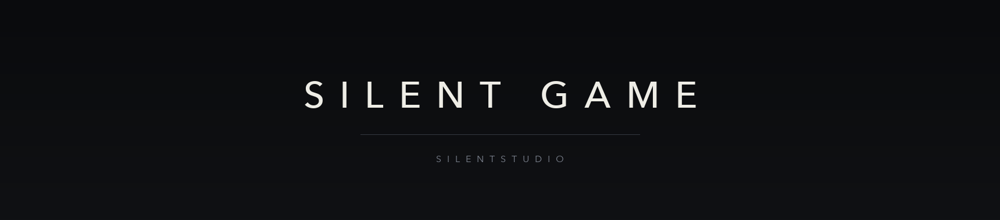

  

  <a href="README.md">简体中文</a> · <a href="README.en.md">English</a> · 日本語 · <a href="README.ko.md">한국어</a> · <a href="README.fr.md">Français</a> · <a href="README.de.md">Deutsch</a> · <a href="README.es.md">Español</a> · <a href="README.ru.md">Русский</a>

Silent Game は SilentStudio のゲームチームです。

Windows、macOS、iOS、Android 向けに作り、その下のエンジンやツール、データ形式も書いています。作業の大半はプレイヤーの目に触れない場所です。

プロジェクトは必ずしもオープンソースではありません。公開しているものには明記します。

## 最近

- 2026-11-05　フィードバック用リポジトリを公開。17 言語のテンプレート
- 2026-11-05　組織ページを 8 言語で公開
- 2026-11-02　エンジン選定をやり直し、結論を記録に残した
- 2026-10-31　設計文書の引用を一通り確認。3 件が合っていなかった

## 参加

- 公開プロジェクトでは issue と pull request を歓迎します。非公開プロジェクトは外部からの参加を受け付けません。
- 各リポジトリの CONTRIBUTING に従ってください。
- 他者の作業を上書きしない。main へ force-push しない。

## リンク

- SilentStudio: https://github.com/Silent-Studio-CN
- SilentStudio プロジェクト索引: https://github.com/Silent-Studio-CN/SilentStudio-ProjectList
- フィードバック: https://github.com/SilentGameTeams/feedback
- 連絡先: SilentStudio@Home.email.cn

最終更新：2026-11-05
