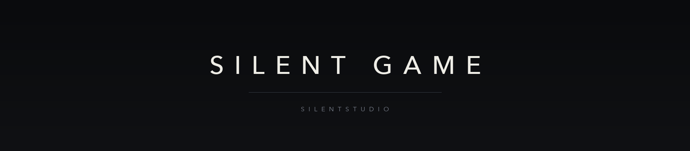

  

  <a href="README.md">简体中文</a> · <a href="README.en.md">English</a> · <a href="README.ja.md">日本語</a> · <a href="README.ko.md">한국어</a> · <a href="README.fr.md">Français</a> · <a href="README.de.md">Deutsch</a> · <a href="README.es.md">Español</a> · Русский

Silent Game — игровая команда SilentStudio.

Делаем для Windows, macOS, iOS и Android и пишем то, что под этим: движок, инструменты, форматы. Большая часть работы — там, куда игрок не смотрит.

Проекты не всегда open source. Публичные об этом говорят.

## Последнее

- 2026-11-05 — Репозиторий отзывов открыт, шаблоны на 17 языках
- 2026-11-05 — Страница организации на восьми языках
- 2026-11-02 — Пересчитали выбор движка, вывод записан
- 2026-10-31 — Проверили нормы, на которые ссылается проектный документ. Три не совпали.

## Участие

- Публичные проекты принимают issues и pull requests. Приватные остаются приватными.
- Следуйте CONTRIBUTING каждого репозитория.
- Не перезаписывайте работу других и не делайте force-push в main.

## Ссылки

- SilentStudio: https://github.com/Silent-Studio-CN
- Индекс проектов SilentStudio: https://github.com/Silent-Studio-CN/SilentStudio-ProjectList
- Обратная связь: https://github.com/SilentGameTeams/feedback
- Контакты: SilentStudio@Home.email.cn

Обновлено: 2026-11-05
